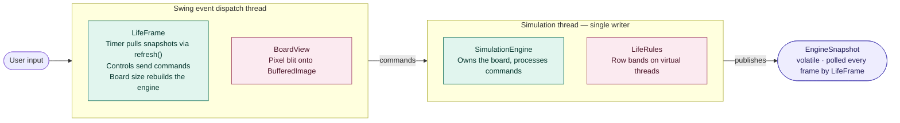
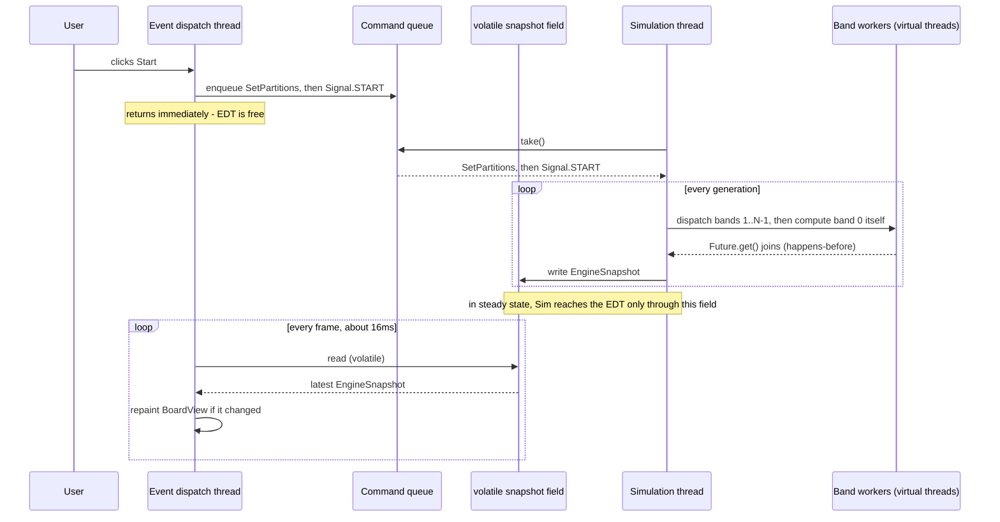

# Conway's Game of Life

**A multithreaded Swing implementation of Conway's Game of Life — and a worked example of
lock-free, single-writer concurrency on modern Java.**


The simulation runs on its own thread and publishes immutable snapshots, so the window
repaints at a steady frame rate no matter how fast generations are produced — more than
ten thousand a second on the default board. Each generation is split into row bands that
run as virtual threads, the renderer writes pixels straight into an image buffer and redraws only
the cells that changed, and the whole path from engine to screen is one `volatile` read.


## Highlights

- **Single-writer actor.** One virtual thread owns the board. The UI never touches its
  state: buttons, the partition spinner and clicks become commands on a `BlockingQueue`.
  Changing the board size is the one control that does not — it replaces the engine
  rather than editing it.
- **Lock-free read path.** Each generation is published together with its statistics as one
  immutable `EngineSnapshot`, through one `volatile` field. The event dispatch thread reads
  it without a lock and can never observe a half-built board.
- **Data-parallel generations.** Row bands run as virtual threads, on the same scheduler as
  the simulation thread that waits on them, while it computes one band itself;
  `Future.get()` supplies the happens-before edge. Measured in the application, the
  dedicated `ForkJoinPool` this replaced was 23.4% slower; virtual threads are 30.6% faster
  ([why](#two-kinds-of-work-one-scheduler)).
- **Work sized to the live area.** Rule evaluation is clipped to a padded bounding box of the
  live cells, and the band count is capped by how many rows that box spans, so a small
  pattern on a large board runs inline instead of being split into empty bands.
- **Rendering on its own clock.** A Swing `Timer` pulls the newest snapshot at a fixed
  rate, about 60 frames a second by default. Generations produced between frames are
  skipped, never queued.
- **An incremental, HiDPI renderer.** Packed RGB goes straight into the `int[]` behind one
  `BufferedImage` at the display's scale factor, and only cells whose color changed are
  rewritten.
- **Compiler-checked commands.** A `sealed` command hierarchy is consumed by an exhaustive
  pattern-matching `switch`: a command that is not handled does not compile.
- **Decisions settled by measurement.** A benchmark harness with three executor modes
  ~~chose the executor and~~ derived the partition rule. **Corrected 2026-10-01:** the
  executor was chosen by measuring the application itself, because the harness's ranking
  reverses there. The numbers, and their caveats, are below.
- **122 headless tests**, including an equivalence test that runs 2 to 8 parallel bands
  against the single-threaded result.

## Contents

- [Quick start](#quick-start) — build, run, controls
- [Configuration](#configuration) — every system property
- [Architecture](#architecture) — threads, components, data flow
- [Design: how the threading works, and why](#design-how-the-threading-works-and-why) — the
  interesting part
- [Modern Java, where it earns its place](#modern-java-where-it-earns-its-place)
- [Testing](#testing)
- [Performance](#performance) — the benchmark, how the executor and partition rule were
  chosen, and how JDK versions are compared
- [JVM tuning](#jvm-tuning)
- [Further reading](#further-reading)

## Quick start

**Requirements:** exactly JDK 27, and Maven. This is the `java27` branch: the build targets
release 27 and adopts two preview APIs, so it must run on JDK 27 (`JAVA_HOME`) — preview
class files refuse to load on any other release, older or newer — and every launch command
must carry `--enable-preview`, which cannot be recorded in the jar manifest. Without it the
jar fails with `UnsupportedClassVersionError` naming `com/conway/model/PatternLoader`. The
JDK 21 build is on `main`, the JDK 25 build on `java25`. The application needs a display; the
tests do not.

```bash
mvn clean package
```

```bash
java --enable-preview -jar target/GuiLife.jar
```

`package` runs the test suite and builds a self-contained (shaded) jar, so no sibling
`libs/` directory is needed.

The board opens with two Gosper glider guns in opposite corners. Click any cell to toggle
it — including while the simulation is running, because an edit is queued to the
simulation thread like every other command.

### Controls

| Control | Mnemonic | Effect |
| --- | --- | --- |
| Board size | — | 200, 400 or 800 (simulated as 201, 401 or 801 cells; the extra cell is a grid detail). Changing it discards the run and seeds a fresh board |
| Parallel partitions | — | Row bands each generation is split across. Defaults to a value chosen for the board and machine, and is re-derived whenever the board size changes |
| Start / Stop | S / T | Run continuously, or pause |
| Next generation | N | Advance exactly one generation |
| Clear | C | Empty the board and reset the generation counter |
| Quit | Q | Shown in red. Closes the window, which stops the render timer and shuts the engine down |

While a run is in progress only Stop, Quit and cell editing stay enabled; everything else
becomes available again once the simulation is stopped.

The status bar shows the generation number, generations per second over the current run
(manual steps are excluded, so think time does not skew it), the population, the partition
count and whether the engine is running. The partition figure is the count *requested*:
the engine runs fewer bands when the live cells span too few rows to fill them (see
[the band cap](#the-per-generation-band-cap)).

Live cells are mint, cells that have died turn plum, and cells where nothing has ever
lived stay near-black. A cell you switch off yourself reverts to near-black rather than
plum.

## Configuration

Every setting is a system property. A numeric value that does not parse, or falls outside
its range, is ignored with a logged warning and the default is used instead.

| Property | Default | Range | Meaning |
| --- | --- | --- | --- |
| `conway.gridSize` | `201` | 3–10,000 | Board width and height in cells, and the size selected on startup. A value that is not a preset is added to the board-size control rather than replaced |
| `conway.boardSizePx` | `1000` | 50–20,000 | Target board size in pixels; cell size is `max(1, boardSizePx / gridSize)` |
| `conway.targetFps` | `60` | 1–240 | Repaint rate, independent of the simulation rate |
| `conway.maxPartitions` | `min(gridSize, max(2, 2 × cores))` | 1–`gridSize` | Upper bound for the partition control. ~~The band workers' parallelism is `min(maxPartitions, cores)`~~ **Corrected 2026-10-01:** it does not size the band workers. They are virtual threads, run by the JDK's scheduler at a parallelism of the core count unless `-Djdk.virtualThreadScheduler.parallelism` overrides it |
| `conway.partitions` | `clamp(gridSize / minRowsPerPartition, 1, maxPartitions)` | 1–`maxPartitions` | Partition count for the startup board; overrides the recommendation |
| `conway.minRowsPerPartition` | `50` | 1–`gridSize` | Rows a band needs before splitting again pays off. Retunes the startup recommendation only ([why](#how-the-default-partition-count-is-chosen)) |
| `conway.log.dir` | `logs` | — | Directory for `conway-life.log`, rolled daily and at 10 MB, with 14 days and at most 200 MB kept |
| `conway.log.level` | `INFO` | — | Root log level |

```bash
java --enable-preview -Dconway.gridSize=401 -Dconway.log.level=DEBUG -jar target/GuiLife.jar
```

## Architecture



Commands flow one way, from the UI into the engine's queue. Per-generation state flows
back only through `EngineSnapshot`, an immutable bundle published through a single
`volatile` field that the render loop polls on a fixed timer — nothing pushes it.
Lifecycle state (paused, running, stopped, failed) is separate: it lives in a second
`volatile`, and each change is pushed to an `EngineListener`, which `LifeFrame` re-dispatches
onto the EDT with `invokeLater`. Apart from the engine's own band workers — which read the
previous generation and write disjoint slices of the next one's fresh arrays — nothing
outside the simulation thread ever touches the board.

### Threads

| Thread | Kind | Work | Blocks on |
| --- | --- | --- | --- |
| Event dispatch thread | Swing | Input, the render timer, all painting | Nothing in steady state; `sync()` and `close()` only when the board size changes or the window closes |
| `conway-simulation` | Virtual | Owns the board, applies commands, computes band 0 of each generation, publishes snapshots | `take()` while paused; `Future.get()` on its band workers while running |
| Band workers | Virtual, one per band (`newVirtualThreadPerTaskExecutor`), on the simulation thread's scheduler | Bands 1…N−1 of each generation | Never — pure CPU |
| `main` | Platform | Reads configuration, builds the engine, seeds the first board, hands off to the EDT | `sync()`, once, until the seed is on the board |

### Components

| Component | Role |
| --- | --- |
| [`SimulationEngine`](src/main/java/com/conway/engine/SimulationEngine.java) | The actor. Owns the board, drains the command queue, publishes snapshots |
| [`Command`](src/main/java/com/conway/engine/Command.java) | The sealed vocabulary: a `Signal` enum for data-free commands, records for the rest |
| [`LifeRules`](src/main/java/com/conway/engine/rules/LifeRules.java) | Schedules a generation: splits it into row bands, runs them on a borrowed executor, assembles the result |
| [`BandKernel`](src/main/java/com/conway/engine/rules/BandKernel.java) | The hot loop: applies the rules to one band of rows, clipped to the active region |
| [`PartitionPlanner`](src/main/java/com/conway/engine/rules/PartitionPlanner.java) | The measured rows-per-band rule, both for the default partition count and for the per-generation band cap |
| [`Generation`](src/main/java/com/conway/model/Generation.java) | The immutable board: flat `boolean[]` alive and ever-alive flags (handed out unwrapped, read-only by contract), active region, population |
| [`EngineSnapshot`](src/main/java/com/conway/engine/support/EngineSnapshot.java) | A generation and its [`SimulationStats`](src/main/java/com/conway/engine/support/SimulationStats.java), published as one unit |
| [`LifeFrame`](src/main/java/com/conway/ui/LifeFrame.java) | The window: controls, status bar and render timer. Translates gestures into commands |
| [`BoardView`](src/main/java/com/conway/ui/BoardView.java) | The incremental pixel renderer and pointer-to-cell mapping |
| [`GenerationBenchmark`](src/main/java/com/conway/bench/GenerationBenchmark.java) | Headless throughput harness with three executor modes |

The grid is bounded, not toroidal: neighbors off the edge count as dead. Patterns are
data — plaintext [`.cells`](src/main/resources/patterns) resources — not hard-coded index
assignments.

## Design: how the threading works, and why

The application is a single-writer actor with an immutable-snapshot read path. This
section explains *why* it is shaped that way. If you have not written a multithreaded GUI
before, this is the interesting part.

### The one constraint everything follows from

Swing has one rule that shapes everything: **only the event dispatch thread (the EDT) may
touch a Swing component.** That thread is also the one that delivers button clicks and
repaints the window. So if you compute a generation directly inside a button's
`ActionListener`, the EDT is busy doing that work and cannot repaint or respond to
anything — the window goes gray and the OS reports it as not responding.

Meanwhile, a Game of Life board is real CPU work, repeated forever: at the default
201×201 board the engine produces thousands of generations per second, each one
touching tens of thousands of cells.

Those two facts force the shape of the whole application:

1. The simulation must run on its **own thread**, not the EDT.
2. The EDT must be able to **display** the board without waiting for that thread.
3. The EDT must be able to **control** the simulation without waiting for it either.

Every pattern below is an answer to one of those three points.

### What breaks if you just share the board

The obvious first attempt is one board that both threads use — the simulation thread
writing cells, the EDT reading them to paint. It fails two ways, and the second is the
dangerous one.

**1. Torn reads.** Writing a single `boolean` into an array is atomic, so no one cell is
ever half-written. But nothing makes the board *as a whole* atomic. The simulation thread
needs thousands of writes to finish generation N+1, and the EDT can paint partway through
— producing a frame that is part N, part N+1. Not a stale board: one that never existed.
Gliders tear in half.

**2. Visibility.** Without `volatile` or a lock, the Java Memory Model gives **no
guarantee that one thread's write is ever seen by another**. The JIT may hoist the read
out of the render loop, and each core has its own caches. A perfectly legal outcome is
the EDT painting the starting board forever while the simulation runs behind it — and the
code looks correct the whole time.

Locking fixes both, at a price: the EDT blocks on a lock held by a thread mutating
thousands of times a second, and every future access has to remember to take it.

### The fix: never mutate what another thread can see

Instead of guarding mutation, this codebase removes it. `LifeRules` builds each new board
in *fresh* arrays and transfers ownership via `Generation.adopt(...)`, so a published
`Generation` is never written to again. The entire handoff to other threads is one
assignment:

```java
private volatile EngineSnapshot snapshot;

private void publish(Generation generation, SimulationStats stats) {
    snapshot = new EngineSnapshot(generation, stats);
}
```

It works because of a JMM rule called **safe publication**: writing a reference to a
`volatile` field guarantees that everything the writing thread did *before* that write —
including fully constructing the object — is visible to any thread that later reads the
field. A reader therefore gets a completely built `Generation`, or the previous one.
Never a mixture.

And because the object is immutable, there is no *second* problem: once you hold it,
nothing can change it under you. There is nothing left to lock.

Strictly, that immutability is a contract the code keeps rather than one the compiler
enforces. `Generation.aliveCells()` and `everAliveCells()` hand out the arrays themselves,
unwrapped, so `BandKernel` and `BoardView` can read a board without copying it — and neither
ever writes to them.

Two consequences worth noticing in the code:

- The board and its statistics are bundled into one `EngineSnapshot` rather than
  published as two fields, so the status bar can never show generation N+1's number
  next to generation N's population.
- Because a new instance is published per change, `BoardView.setGeneration` can test
  `generation != displayed` — plain reference identity — to decide whether anything
  changed. No deep comparison needed.

### Commands travel the other way, through a queue

Point 3 from above: the EDT has to start, stop and edit the simulation without blocking.
It cannot call into the simulation thread's state directly — that would just recreate
the shared-mutable-state problem in the opposite direction.

So every control that edits the simulation is a message. (The board-size control is the
one exception, and it does not edit the board at all: on the EDT, and only while paused,
`LifeFrame.applyBoardSize` closes the engine and constructs a new one with a new view.)
`SimulationEngine`'s mutating methods — `start`, `pause`,
`step`, `clear`, `toggleCell`, `place` and `setPartitions` — do nothing beyond validating
or clamping their arguments where needed (`place` rejects a null pattern, `setPartitions`
clamps into range) and putting an object on a queue:

```java
public void start() { submit(Command.Signal.START); }
public void toggleCell(int row, int col) { submit(new Command.ToggleCell(row, col)); }
```

The rest of the public surface works differently, by design: `snapshot()`,
`currentGeneration()`, `stats()` and `state()` read published `volatile` fields;
`maxPartitions()` returns a value fixed at construction; `addListener` registers a
callback; and `sync()` and `close()` deliberately block — one until every earlier command
has been processed, the other until the simulation thread has stopped.

On the simulation thread, `handle` only routes: each command has its own small handler
(`handleStart`, `handleStep`, `handleToggleCell` and so on), so what any one command does
can be read in a single short method.

`Command` is a `sealed interface` implemented by an enum of data-free signals and by
records for the commands that carry data, so the loop that consumes it can `switch` over
every case with the compiler checking that none was forgotten. The EDT returns from
`start()` in microseconds, whatever the engine is doing.

The consuming loop has one detail worth studying:

```java
Command command = running ? commands.poll() : commands.take();
```

- **Running:** `poll()` returns `null` immediately if no command is waiting, so the loop
  falls through and computes the next generation. Commands are still picked up between
  generations.
- **Paused:** `take()` *blocks* until something arrives. An idle engine therefore burns
  no CPU at all, and — unlike a `wait()`/`notify()` pair — a step request that arrives at
  an awkward moment cannot be lost, because it is sitting in the queue rather than being
  a notification that may have already fired.

This is the **actor** pattern: one thread owns the state, and everyone else sends it
messages.

### Two kinds of work, one scheduler

The simulation thread spends its life blocked — in `take()` while paused, in
`Future.get()` while its band workers finish — so it is a **virtual thread**: it unmounts
from its carrier while blocked and costs nothing while idle. Virtual threads are daemon
threads, so the JVM can still exit if a shutdown path is missed.

The band workers are **virtual threads too**, one per band, and the reason is the thread
above rather than the bands themselves. `computeBand` never blocks: it is pure CPU, which
is not what virtual threads are usually for. But a band on the default board is only about
10,000 cells, and three are dispatched per generation — about 67,000 dispatches a second at
the application's measured 22,283 generations/s — so the cost that matters is the hand-off
between the simulation thread and its bands, not the bands. Because the simulation thread
is virtual, putting the bands on the same scheduler keeps that hand-off cheap.

On the default board each generation is four bands: the simulation thread dispatches three,
computes the fourth itself, and waits in `Future.get()` for the three. (Larger boards run
more bands; a small or sparse board runs a single band inline, with no hand-off at all.)
The JDK schedules virtual threads on its own
`ForkJoinPool`, separate from any pool the application creates:

```text
ForkJoinPool (shipped 2026-09-24 to 2026-10-01) — two pools

  [JDK virtual-thread scheduler]   simulation thread lives here
        │ submit 3 bands → the other pool's outside queue; wake a worker if one is asleep
        ▼
  [application's ForkJoinPool]     bands run here; the simulation thread's carrier idles
        │ band done → wake the simulation thread → outside queue back; wake a carrier
        │             if none is awake to take it
        ▼
  back to the JDK scheduler        ← crosses over and back every generation

Virtual-thread executor (shipped since 2026-10-01) — one pool

  [JDK virtual-thread scheduler: one carrier per core (10 here), each with its own queue]
        simulation thread + all bands here
        • submit 3 bands     → this same pool's outside queue
        • simulation thread waits
                             → its carrier is free to pick up a band instead of idling
        • band finishes      → the simulation thread is queued on that same,
                               already-awake carrier, via the carrier's local queue
```

In one line: a virtual simulation thread plus a virtual-thread executor keeps the whole
generation inside one scheduler, so the wake-up is local and threads that are already awake
do the next piece of work.

Every step is in the JDK source (`lib/src.zip`). The measurements in this section were
taken on JDK 21, so the first column cites OpenJDK 21.0.12.1; the second cites 25.0.4.1,
which this branch requires. JDK 25 reaches the same outcome at every step, by different code
in the three marked †:

| Step | JDK 21.0.12.1 | JDK 25.0.4.1 |
| --- | --- | --- |
| Virtual threads run on a dedicated `ForkJoinPool`, not the common pool and not the application's | `VirtualThread.java:71` (`DEFAULT_SCHEDULER`), built at `:1145–1176` with parallelism = available processors and `asyncMode = true` | `VirtualThread.java:66`, built at `:1432–1458` with the same parameters |
| Starting a virtual thread submits it from the starting thread, **without** switching to the carrier — so dispatch is an outside-queue submission in both designs | `VirtualThread.java:540–560` (`start` → `submitRunContinuation`) | † `VirtualThread.java:689–709` → `:420–431`: started from a carrier, it calls `externalSubmit` explicitly |
| Submission goes to the submitting thread's own local deque only if it is a worker of that same pool; otherwise to an outside submission queue | `ForkJoinPool.java:2358–2372` (`poolSubmit`: `:2363–2365` local, `:2366–2368` outside); `execute` reaches it at `:2846–2849` | † `ForkJoinPool.java:2614–2627`, which tests the *carrier* (`JLA.currentCarrierThread()`, `:2616`), so a virtual thread counts as a worker of its carrier's pool; `execute` at `:3178–3181` |
| A virtual thread unparking another resubmits it from its own carrier — the local deque | Switches to its carrier first: `VirtualThread.java:742–748`, then `:262–264` (`submitRunContinuation` → `scheduler.execute`) | † No switch: `unpark` (`VirtualThread.java:851–861`) → `:385` → `:336–342`, which pins the continuation so the carrier cannot change while `poolSubmit` reads it |
| A platform thread unparking a virtual thread resubmits directly — an outside submission | `VirtualThread.java:750` | `VirtualThread.java:860` → `:344`; `poolSubmit` takes the outside branch, `ForkJoinPool.java:2621–2623` |
| `Future.get()` waits with `LockSupport.park`, not a monitor. The virtual-thread executor's futures are `FutureTask`s; the `ForkJoinPool`'s are `ForkJoinTask`s | `ThreadPerTaskExecutor.java:327–328`, `FutureTask.java:500`; `ForkJoinTask.java:459`, `:461` | `ThreadPerTaskExecutor.java:304–305`, `FutureTask.java:511`; `ForkJoinTask.java:442`, `:445` |

So the difference is in the wait and the wake-up, not the submit. The virtual-thread
scheduler is itself a work-stealing `ForkJoinPool`, so uneven bands (rule evaluation is
clipped to the active region) and the reference machine's asymmetric cores (6 performance +
4 efficiency) are still absorbed by stealing. Nothing is sized, so nothing has to be resized
when the partition control moves.

**It is not pinning.** Because ~~`ForkJoinTask.get()`~~ `Future.get()` parks rather than
holding a monitor, a virtual thread blocked on it unmounts normally. **Corrected
2026-10-01:** with the virtual-thread executor the future is a `FutureTask`, not a
`ForkJoinTask`; both park (last row above). JFR with `jdk.VirtualThreadPinned` at a 0 ms
threshold captured zero pins on JDK 21 under both executors ([JVM tuning](#jvm-tuning)).

**Not established:** the cost of each hand-off. The gap is 13.7 µs per generation (58.6 µs
under `ForkJoinPool` against 44.9 µs under virtual threads), consistent with a few thread
wake-ups per generation, but the wake-ups were not counted. JFR's thread-park and
context-switch events on the two arms would count them.

> **Corrected 2026-10-01.** From 2026-09-24 this section argued the opposite, and the code
> followed it:
>
> ~~The band workers are the opposite shape. `computeBand` never blocks: it is pure CPU, at
> tens of thousands of band dispatches per second (about 50–60k on the default board) —
> exactly the case virtual threads do not address. They run on a dedicated
> `ForkJoinPool`, for two reasons: work stealing, and cheaper hand-off through per-worker
> deques.~~
>
> ~~Measured, this is 12–19% faster than virtual-thread workers on the default board at four
> partitions, and at parity on an 801 board.~~
>
> The measurement was real, but it was taken in `GenerationBenchmark`, whose waiting thread
> is a platform thread. In the application, whose waiting thread is virtual, the dedicated
> `ForkJoinPool` was **23% slower**. [Choosing the executor](#choosing-the-executor) has the
> numbers.

### Inside one generation: parallelism without locks

The board is split into contiguous **row bands**. Band *k* reads the previous generation
(which nobody is writing) and writes only its own rows of the new arrays. Because no two
bands ever write the same memory, and what they read is never written, the workers need no
lock or atomic between themselves.

Three details in how [`LifeRules`](src/main/java/com/conway/engine/rules/LifeRules.java)
runs a generation that a diagram would hide:

- **The caller works too.** The simulation thread does not just dispatch and wait. It
  submits bands 1..N−1 to the executor and then computes **band 0 itself**, so it does
  useful work instead of parking for the whole generation.
- **Joining is what makes the result safe to read.** `Future.get()` blocks until that band
  is done *and* establishes a happens-before edge, which is the guarantee that the
  worker's writes are visible to the joining thread. Band 0 needs no join because the
  same thread wrote it.
- **Failure is loud.** If any band throws, the bands still pending are canceled and the
  generation is abandoned as a `SimulationException` — never published half-computed.
  The engine pauses and enters `FAILED`, and `LifeFrame` shows an error dialog.

Splitting is a pure work-distribution choice: the resulting board must be identical
whatever the band count, which is exactly what
[`PartitionEquivalenceTest`](src/test/java/com/conway/engine/rules/PartitionEquivalenceTest.java)
asserts. That test is the safety net for the whole parallel path.

### Rendering runs on its own clock

A tempting design is "compute a generation, repaint, repeat". This codebase deliberately
does not do that. `LifeFrame` starts a Swing `Timer` at `conway.targetFps` (60 by
default) and, on each tick, reads whatever has been published:

```java
EngineSnapshot snapshot = engine.snapshot();   // one volatile read
```

If the engine produced 300 generations since the last tick, 299 are simply never drawn —
and that is correct, because the display cannot show them anyway. The benefit runs both
ways: the simulation is never throttled by repaint backpressure, and the timer coalesces
its ticks, so the EDT never has a frame backlog to work through.

Each frame is also cheap. `BoardView` remembers the generation its image already shows: a
repaint caused by exposure or a resize just re-blits that image, and a new generation of
the same size rewrites only the cells whose color changed. The image is rendered at the
display's scale factor, so cells stay crisp on a Retina screen, and it is letterboxed into
the window, so cells stay square at any window size.

### Trace: one click, end to end



In steady state the two loops are independent. Neither waits for the other, and the only
things crossing between them are a queue in one direction and a single field in the other.
That describes the running simulation, not every path through the code:

- **Lifecycle news is pushed, not polled.** State changes and errors go through
  [`EngineListener`](src/main/java/com/conway/engine/EngineListener.java). Each callback
  runs on the thread that caused the change — the simulation thread, except for
  `STOPPED`, which `close()` raises on its caller's thread — so `LifeFrame` wraps every one
  in `SwingUtilities.invokeLater` before touching a component. Per-generation updates are
  deliberately *not* sent this way; that would put the simulation rate back in charge of
  the frame rate.
- **`sync()`** blocks its caller on a latch until every command queued before it has been
  processed. The seeder uses it so the first frame of a board already shows the seeded
  pattern — on the main thread at startup, and on the EDT when the board size changes.
- **`close()`** joins the simulation thread, and `LifeFrame` calls it on the EDT — when the
  window closes, and when the board size changes.
- **`Future.get()`**: the simulation thread does wait in every generation split into more
  than one band — for its own band workers, never for the EDT.

So the EDT genuinely waits for the simulation in exactly two situations: closing the
window, and changing the board size, which closes the old engine and seeds the new one,
both synchronously. Both waits are short. The board-size control is disabled while a run
is in progress, and `close()` returns once the in-flight generation finishes — or, if the
thread has not stopped within 5 seconds, interrupts it and waits up to 5 more.

### Concepts glossary

| Term | What it means here |
| --- | --- |
| Event dispatch thread (EDT) | The one thread Swing allows to touch components. Blocking it freezes the UI |
| Torn read | Observing a mix of old and new values because the update was not atomic as a whole |
| Visibility | Whether one thread's write is guaranteed to be seen by another. Not automatic in Java |
| Safe publication | Writing a reference to a `volatile` field so readers see a fully constructed object |
| Happens-before | The JMM ordering guarantee that makes one thread's writes visible to another. Supplied here by `volatile` writes and `Future.get()` |
| Actor | One thread owns mutable state; everyone else sends it messages instead of calling it |
| Single-writer principle | Only one thread ever mutates a piece of state, so reads need no lock |
| Virtual thread | A thread, final since JDK 21, that unmounts from its carrier while blocked, so idle ones cost almost nothing |
| Carrier thread | The platform thread a virtual thread runs on while mounted. The JDK's virtual-thread scheduler is a `ForkJoinPool` of them, separate from any pool the application creates |
| Work stealing | An idle `ForkJoinPool` worker takes tasks queued for a busy one, so uneven work does not leave cores idle. The virtual-thread scheduler steals, which is how uneven bands are balanced here |
| Active region | The bounding box of the live cells, padded by one. Rule evaluation is clipped to it, and it caps the band count |

## Modern Java, where it earns its place

Each feature below is used where it removes code or closes off a class of bug.

| Feature | Since | Where | What it buys |
| --- | --- | --- | --- |
| Virtual threads (JEP 444) | 21 | The simulation thread and the band workers in `SimulationEngine` | A thread that is blocked most of its life costs nothing while idle, and bands on the same scheduler as the thread waiting on them make each generation's hand-off cheap |
| Pattern matching for `switch` (JEP 441) | 21 | `SimulationEngine.handle` | Exhaustive dispatch over the sealed `Command` hierarchy |
| Record patterns (JEP 440) | 21 | `SimulationEngine.releasePendingBarriers` | Matches and destructures `Barrier(CountDownLatch latch)` in one step |
| Sequenced collections (JEP 431) | 21 | `Pattern.parse` | `getLast()` and `removeLast()` to trim trailing blank rows |
| `Math.clamp` | 21 | `SimulationEngine.setPartitions`, `PartitionPlanner.recommend` and `bandsFor`, `FlatButton` | One call per range check, for partition counts and color channels |
| `ExecutorService` as `AutoCloseable` | 19 | `SimulationEngine.close`, `GenerationBenchmark` | Shutdown and await in a single call |
| Records and sealed interfaces | 16, 17 | `Command`, `EngineSnapshot`, `SimulationStats`, `ActiveRegion`, `BoardSizeOption` | Closed vocabularies and immutable value types without boilerplate |

Just as deliberately, some features are **not** used. `StructuredTaskScope` would make
band-failure cleanup automatic, but it is still a preview API — in JDK 25 (JEP 505, its
fifth preview) as in 21 — and the project allows no preview features. A `RecursiveTask`
decomposition would replace the band model that `PartitionEquivalenceTest` pins down, for a
few percent. The reasoning for every Java ≤25 concurrency tool is in the
[concurrency features review](docs/concurrency-features-review.md).

## Testing

```bash
mvn test
```

122 tests in 12 classes, all headless: Surefire sets `java.awt.headless=true`, so the UI
tests need no display.

The load-bearing test is
[`PartitionEquivalenceTest`](src/test/java/com/conway/engine/rules/PartitionEquivalenceTest.java).
Partitioning is a work-distribution concern, so the resulting board must not depend on how
many bands the work was split into. The test runs every band count from 2 to 8 on a
401×401 random board, and six bands on a non-square board 131 cells wide and 307 tall,
comparing each generation with the single-threaded result, on the same
virtual-thread-per-task executor the engine uses. That catches off-by-one errors at band
boundaries, rows computed twice or skipped, and accidental sharing of mutable state between
workers. Each of those cases first asserts that the band count it asked for is the one that
actually runs, so the test cannot quietly degrade into comparing the inline path with
itself. It also depends on the executor: swapping in one that rejects every task fails nine
of its ten cases (2026-10-01); the tenth only requests 1, 0 and −4 partitions, which never
dispatch.

| Suite | Pins down |
| --- | --- |
| `PartitionEquivalenceTest` | Identical boards at every band count, plus oversized and non-positive requests |
| `LifeRulesTest` | The rules: still lifes, oscillators, gliders, dead borders, trails, population counts, band-failure reporting |
| `BandCapTest` | The per-generation band cap follows the rows that carry work |
| `PartitionPlannerTest` | The planner reproduces each board's measured optimum and respects the hardware cap |
| `SimulationEngineTest` | Queued steps are never dropped; start, pause, clear and edits during a run; held snapshots never change; `close()` stops the virtual simulation thread and is idempotent |
| `BoardViewTest`, `CellGeometryTest` | Incremental rendering matches a full redraw; letterboxing; pointer-to-cell mapping |
| `GenerationTest`, `PatternTest`, `PatternLoaderTest`, `BoardSizeOptionTest`, `MainSeedingTest` | The immutable model, `.cells` parsing, board-size presets and the startup seed |

## Performance

### Running the benchmark

```bash
java --enable-preview -cp target/GuiLife.jar com.conway.bench.GenerationBenchmark
```

Arguments, all optional: grid size (default 201), generations per measurement (default
300), and the executor — `platform` (the default), `virtual`, or `forkjoin`. The harness
seeds the same two-gun board the application starts with, and measures partition counts
1, 2, 4, 8 and so on, doubling up to the application's own default cap,
`min(gridSize, max(2, 2 × cores))`, plus that maximum itself.

The default executor is **not** the path the application takes. `SimulationEngine` uses a
virtual-thread-per-task executor, which is the harness's `virtual` mode:

```bash
java --enable-preview -cp target/GuiLife.jar com.conway.bench.GenerationBenchmark 201 300 virtual
```

**But no mode reproduces the application, and the harness cannot rank executors for it.**
The harness calls `next()` from `main`, a platform thread; the application calls it from its
virtual simulation thread. That difference reverses which executor wins: in the application
the `ForkJoinPool` is 23.4% slower on the default board
([why](#why-the-harness-and-the-application-disagree)). Use the harness for
the shape of the partition curve, not for the choice of executor.

The three modes exist so that a change of executor is settled by measurement rather than
by argument — which is how both the move to virtual threads and the later move away from
them were decided. ~~The move away~~ **Corrected 2026-10-01:** the move away, on
2026-09-24, was decided on this harness and reversed once it was measured in the
application.

> **Read the numbers as indicative, not precise.** The harness warms up, resets to an
> identical board before each measurement and takes the best of five — enough to show
> the shape of the curve, but it is not
> [JMH](https://openjdk.org/projects/code-tools/jmh/). It also measures partition counts
> in ascending order inside a single JVM, so later rows inherit a warmer JIT; differences
> between adjacent rows are not reliable. At the default 300 generations, a measurement
> on the 201 board lasts only about 20 ms; pass a larger count, such as
> `201 5000 virtual`, to lengthen each one. Reach for JMH before drawing any conclusion
> finer than "does adding threads help at all".

### Parallel speedup on the default board

Measured on a 201×201 board with the ~~shipping~~ `forkjoin` executor — the shipping one
from 2026-09-24 to 2026-10-01; this table has not been re-measured since the engine moved
back to virtual threads, and like everything from the harness it has a platform thread
waiting — Apple M2 Pro (6 performance + 4 efficiency cores), JDK 25, 300 generations per
measurement. Two layers
of "best of" are involved: each invocation of the harness reports its own best of five,
and each figure below is the best of **four separate invocations**, interleaved with the
other executor modes.

| Partitions requested | Bands actually run | Generations/s | Speedup |
| --- | --- | --- | --- |
| 1 | 1 | 13,131 | 1.00× |
| 2 | 2 | 18,421 | 1.40× |
| 4 | 4 | 19,473 | 1.48× |

**Parallelism buys about 1.5× on this board** — roughly half as much again, not a sharp
optimum: 2 and 4 are close enough that run-to-run spread can reorder them. The machine
also carried about one core of unrelated background load, so the parallel rows are
conservative. The table stops at 4 on purpose: on this board every larger request runs
the same four bands (see [the band cap](#the-per-generation-band-cap)).

A generation takes about 76 µs single-threaded and about 51 µs across four bands. At that
scale, task dispatch and the join barrier are a large share of the work, which is why the
curve flattens so early. It also puts the simulation more than 200× ahead of a 60 fps
display, so on the default board the threading changes nothing you can see; decoupling
rendering from the simulation is what matters there. Parallelism earns its keep on larger
boards, [below](#how-the-default-partition-count-is-chosen).

### Choosing the executor

> **Corrected 2026-10-01: the ranking below reverses in the application, and the engine now
> uses virtual threads.** The table is a real measurement, but of the harness, which calls
> `next()` from `main`, a platform thread. The application calls it from its virtual
> simulation thread, and that is what decides which executor wins. The original analysis is
> kept as a record; [what the application measured](#what-the-application-measured) and
> [why the two disagree](#why-the-harness-and-the-application-disagree) follow it.

The band workers never block, so the choice of executor is a question about dispatch cost
and load balancing~~, not about concurrency~~ — and, it turned out, about which scheduler
the thread waiting on them runs on. All three modes were run round-robin
(`platform`, `virtual`, `forkjoin`, repeat) so background load fell evenly on each. Every
cell is the best across separate invocations of the harness, each reporting its own best
of five: four invocations of 300 generations for the 201 rows, three of 200 for the 801
rows.

| Board | Partitions | `platform` | `virtual` | `forkjoin` |
| --- | --- | --- | --- | --- |
| 201 | 1 | 12,820 | 13,258 | 13,131 |
| 201 | 2 | 18,300 | 17,722 | **18,421** |
| 201 | 4 | 17,268 | 17,422 | **19,473** |
| 201 | 8 † | 17,380 | 18,620 | 19,254 |
| 801 | 4 | 3,191 | 3,226 | 3,216 |
| 801 | 16 | 3,636 | 3,833 | 3,865 |

- ~~**At 201 with the recommended four partitions, work stealing wins.** It is worth about
  12% over virtual threads on the best figures, and nearer 19% on the means. A band there
  is only ~10,000 cells, so dispatch overhead is a real fraction of the work, and a
  `ForkJoinPool`'s per-worker deques beat a single contended queue at about 50–60k
  dispatches a second — each generation dispatches three of its four bands and computes
  the fourth inline.~~ **Corrected 2026-10-01:** true of the harness only. With a virtual
  thread waiting, as in the application, `forkjoin` is 23% *slower*. The premise survives —
  a band is only ~10,000 cells, so the hand-off is a real fraction of the work — and is
  exactly why which scheduler the hand-off crosses matters so much.
- **At 801, the executor stops mattering.** A band carries four to sixteen times the cells
  of a 201 band (at 16 and 4 partitions respectively), so the three executors land within
  ±4% of their mean — 3,191 to 3,226 at 4 partitions, 3,636 to 3,865 at 16. Harness
  figures, not re-measured in the application.
- **The 1-partition row is the control.** It computes inline on the calling thread with
  no dispatch at all, so all three modes agreeing there says the harness is measuring what
  it claims to.

† On a 201 board a request for 8 partitions runs the same four bands as a request for 4,
so this row repeats the 201 | 4 row's work under a different label. It is kept to show
the run-to-run spread, not as a scaling result, and its winner is deliberately not
highlighted.

#### What the application measured

The application itself, on 2026-09-30: `drive.GuiDrive` running the real window for
2,000,000 generations, JDK 21.0.12.1, commit `13fc868`, five runs per arm interleaved by
repetition, the two arms differing only in the executor line of `SimulationEngine`:

| Band executor | Median generations/s | Range of five runs |
| --- | --- | --- |
| `ForkJoinPool`, parallelism `min(maxPartitions, cores)` — shipped 2026-09-24 to 2026-10-01 | 17,058.7 | 15,935.3–17,652.1 |
| Virtual-thread-per-task — shipped since 2026-10-01 | **22,282.8** | 20,070.5–22,605.9 |

Virtual threads are 30.6% faster; put the other way, the `ForkJoinPool` costs 23.4%. Every
virtual-thread run beat every `ForkJoinPool` run. For scale, an A/A run of the same rig that
day — two arms identical by construction — differed by 1.71%. Only the executor line was
isolated: the rest of the 2026-09-24 commit that introduced the `ForkJoinPool` (`af088a4`,
which also moved packages and extracted classes) was not re-measured.

#### Why the harness and the application disagree

The one variable that differs between them is the thread waiting on the bands. Crossing it
with the executor — headless, JDK 21.0.12.1, 4 partitions, seven interleaved repetitions of
50,000 generations, 2026-10-01:

| Thread waiting on the bands | `forkjoin` | `virtual` |
| --- | --- | --- |
| Platform, as in `GenerationBenchmark` | 17,139 | 16,253 |
| Virtual, as in the application | 17,022 | **20,917** |

`forkjoin` does not care who waits: 17,139 against 17,022. `virtual` gains 28.7%, but only
when the waiter is itself a virtual thread. Each row reproduces one of the two contradictory
results — the platform row is the harness's ordering, the virtual row the application's.

The mechanism is in [Two kinds of work, one scheduler](#two-kinds-of-work-one-scheduler):
the virtual-thread executor's advantage exists only when it shares a scheduler with the
thread waiting on the bands. In the harness that thread is `main`, a platform thread, so
neither executor shares its scheduler; the virtual-thread executor pays for a thread per band
with nothing to gain, and `forkjoin` edges ahead.

### How the default partition count is chosen

Parallelism pays off as a function of the *board*, not the core count. Speedup over a
single partition, same machine and harness:

| Board | 1 | 2 | 4 | 8 | 16 | 20 | Best |
| --- | --- | --- | --- | --- | --- | --- | --- |
| 201 | 1.00× | 1.13× | **1.15×** | 1.11× | 1.08× | 1.03× | 4 |
| 401 | 1.00× | 1.66× | 2.23× | **2.30×** | 2.27× | 2.17× | 8 |
| 801 | 1.00× | 1.80× | 3.13× | 3.07× | **3.53×** | 3.52× | 16 |
| 1601 | 1.00× | 1.86× | 3.39× | 3.95× | 4.92× | **5.10×** | 20 |

Two health warnings on this table. It predates the per-generation band cap, so the
right-hand columns no longer measure distinct configurations (see
[below](#the-per-generation-band-cap)); these rows have not been re-measured since. And it
is a different session from the tables above — which report 1.48× where this one reports
1.15× for the same 201 board at 4 partitions. ~~That ~29% disagreement between runs of the
same configuration is the harness's real precision~~ **Corrected 2026-10-01:** it is not the
same configuration. This table was recorded on 2026-07-31, when the harness had only a fixed
pool of platform threads, every band was dispatched through `invokeAll` (the calling thread
did not yet compute one), and the build targeted release 17. The ~29% gap mixes those
changes with run-to-run noise, so it does not measure the harness's precision — but it is
still a good reason to trust only the shape of the curve.

The shape is clear, though: at every size the fastest result lands at roughly **fifty rows
per band**, and the largest board is still improving when it hits the cap. That invariant
is the rule [`PartitionPlanner`](src/main/java/com/conway/engine/rules/PartitionPlanner.java)
implements: `clamp(rows / 50, 1, maxPartitions)`. It reproduces the measured optimum at
all four sizes, and it keeps small boards single-threaded instead of paying dispatch cost
for work that does not exist.

Two consequences worth knowing:

- **One partition per core was slower.** Defaulting to `availableProcessors()` measured
  slower than the chosen value when these numbers were recorded — 10 partitions sat past
  the peak. The per-generation cap has since made the two equivalent on the default board,
  because both end up at four bands; the planner still earns its place on larger boards,
  where the request is not capped away.
- **The cap deliberately allows more bands than cores.** `hardwareCap` is
  `min(rows, max(2, 2 × cores))`, so a large board may request up to twice the core count.
  On asymmetric cores (6 performance + 4 efficiency), a generation ends at a barrier, so an
  efficiency core given an equal share delays everyone; smaller bands let the faster cores
  absorb proportionally more.

The constant was calibrated on one machine and one JDK, and it is less adjustable than the
two related properties suggest. `-Dconway.minRowsPerPartition=N` and
`-Dconway.partitions=N` both set only the partition count the application *starts* with:
a board-size change recomputes it with the built-in 50, and the per-generation cap always
uses 50. So either property can reduce the number of bands — a larger N, or a smaller
count — but neither can push past `floor(activeRows / 50)`.

### The per-generation band cap

The engine applies the same rows-per-band rule again on every generation, against the
**active region** — a padded bounding box of the live cells, not the full grid — and
computes inline when there is too little live area to fill the bands. A generation is
split across at most `floor(activeRows / 50)` bands (`PartitionPlanner.bandsFor` floors a
too-small region to one band before clamping).

What counts is how many rows the live cells span, not how many live cells there are. A
board whose live cells span fewer than 100 rows once padded is capped to a single band,
while the default seed, sparse as it is, spans all 201 rows and runs four. The cap exists
because splitting work that is not there is pure overhead: on a 201×201 grid holding a
single blinker, sixteen bands ran about six times slower than computing inline — 52.1 µs a
generation against 8.5.

It also explains the benchmark tables above. A full board caps at four bands at 201,
eight at 401 and sixteen at 801, so in each row of the partition table every column at or
beyond that point repeats the same work, and the differences between them are
measurement artifact rather than scaling. Only the 1601 row still varies across all six
columns.

### Comparing JDK versions

`GenerationBenchmark` is the wrong instrument for comparing JDKs: it measures a harness, and
the [executor episode](#why-the-harness-and-the-application-disagree) shows a harness can rank
things the opposite way to the application. JDK comparisons are therefore run on the shipping
application, with two pieces kept in this repository:

| Piece | Where | What it is |
| --- | --- | --- |
| Rig | `tools/bench/` | `drive/GuiDrive.java` drives the real window, event dispatch thread and repaint for a fixed number of generations. `drive/GateCheck.java` steps a seeded board an exact number of generations and hashes it, so two JVMs are shown to compute the same board before any timing is compared. `bench.conf.example` and `jdks.conf.example` are the templates for the live configs, which stay gitignored |
| Method | `.claude/skills/jdk-performance-comparison/` | A project-level Claude Code skill: the procedure (interleaved arms, a measured noise floor, separate rounds with and without JFR, the JVM read back from every recording), the runner `scripts/run-matrix.sh` and the JFR parser `scripts/parse_jfr.py` |

Claude Code picks the skill up automatically in this repository: ask it to compare JDK
versions, or invoke `/jdk-performance-comparison`. The scripts also run on their own from the
repository root; the exact steps for the last comparison are in
[the profiling log](PROFILING-LOG.md#reproducing). Raw output goes to `profiling/`, which is
gitignored, so a comparison's numbers are kept by writing them into the log.

Two traps catch runs started by hand rather than through the runner:

- **An IDE run configuration uses the IDE's JDK, not the one you meant.** On the reference
  machine IntelliJ's project SDK is `corretto-25` (Amazon Corretto), a different vendor from
  the Homebrew OpenJDK builds being compared. Launch through the runner instead: it resolves
  each JDK itself, checks `java -version` before every run, and the JVM is read back from
  every recording afterwards.
- **Profile with JFR, not IntelliJ's profiler.** Every virtual-thread mount and unmount calls
  a JVMTI notification hook (`VirtualThread.mount()` → `notifyJvmtiMount` in the JDK 21
  source), and an attached JVMTI agent — which is how IntelliJ's profiler works — makes that
  hook do real work. Both the simulation thread and the bands are virtual threads, so mounts
  happen several times per generation, and the profiler distorts exactly the path being
  measured.

The latest comparison, on 2026-10-01: JDK 25 commits half the heap of JDK 21 (296 against
620 MiB) with no measurable throughput difference: two identical JDK 21 arms differed by
3.90%, about as much as JDK 21 and JDK 25 did (+4.5% to +5.1%), and every range overlapped.

## JVM tuning

The full checklist — which flags for which case, which old flags now stop the JVM from
starting, and the measurements behind every recommendation — is in
[`docs/jvm-options.md`](docs/jvm-options.md). The short version:

The dominant allocation is two `boolean[]` per generation — about 80 KB on the default
board, or roughly 1.1–1.8 GB/s at the rates measured above (13,131 to 22,283 generations/s).
That is steady, short-lived garbage, and G1 absorbs it easily. On the default board with a
1 GB heap, two 12-second JDK 21 runs gave a median pause of 0.51 ms and a worst of 7.28 ms,
and a 20-second JDK 25 run of the ~~current~~ engine gave 0.44 ms and 1.80 ms — every pause
inside a 16.7 ms frame. **Corrected 2026-10-01:** both were recorded with the
`ForkJoinPool` band workers (published 2026-09-24 and 2026-09-29), and neither has been
repeated since the engine moved back to virtual threads. The two arrays are unchanged; what the move adds is a
virtual thread per dispatched band.

| Case | Flags | Why |
| --- | --- | --- |
| Every run | `-Xms256m -Xmx1g` | Bounds the heap; without `-Xmx` the reference machine allows 8 GB. A gigabyte is ample for the default board. The doc's full baseline adds a heap dump, an error file and a GC log |
| Interactive use, default board | `-XX:+UseG1GC -XX:MaxGCPauseMillis=20` | States the default collector. The pause goal is inert here: no pause came near 20 ms |
| Smoothest possible frames | `-XX:+UseZGC` | Worst pause 0.02 ms at the same throughput (measured on JDK 21). Generational is ZGC's only mode since JDK 24; JDK 25 ignores `-XX:+ZGenerational` with a warning |
| Large boards | ZGC and a heap sized from the board | G1's pauses grow with the heap; the pixel buffer grows with the board's area |
| Headless benchmark | `-XX:+UseParallelGC` | The throughput collector; pauses do not matter without a UI |

```bash
java --enable-preview -Xms256m -Xmx1g -XX:+UseG1GC -XX:MaxGCPauseMillis=20 -jar target/GuiLife.jar
```

**Size the heap from the board** once it grows past the default. At N×N cells the heap
holds, in the worst case, `8·N² + 4·(c·N·s)²` bytes: the engine's current and next
generations (4·N²), up to two more that `BoardView` still references (4·N²), and the pixel
buffer at 4 bytes per physical pixel, for a cell *c* logical pixels wide
(`max(1, boardSizePx / N)`) at device scale *s*. From N = 501 on the default
`conway.boardSizePx` a cell is one pixel and the last term is `4·N²·s²`, so at the
10,000×10,000 maximum the total is about 1.2 GB on a 1× display and 2.4 GB on a 2× one, and
`-Xmx1g` is **not** enough there:

```bash
java --enable-preview -Xmx3g -XX:+UseZGC -Dconway.gridSize=10000 -jar target/GuiLife.jar   # 1× display
java --enable-preview -Xmx4g -XX:+UseZGC -Dconway.gridSize=10000 -jar target/GuiLife.jar   # 2× (Retina) display
```

Those sizes are derived from the formula plus room for ZGC to allocate while it collects;
the GUI itself was not run at that size.

**Virtual-thread pinning.** JFR recordings on JDK 21, with `jdk.VirtualThreadPinned`'s
threshold lowered to 0 ms, captured zero pins — first when the band workers were still
virtual threads alongside the actor, and again with the ~~current~~ `ForkJoinPool` workers
that shipped from 2026-09-24 to 2026-10-01. JDK 25 recordings of the ~~current~~ engine
**with those workers** have captured **one or two** per run, 3–43 µs each, every one
inside the JDK's own class loading as the first generation starts (a contended monitor
while the simulation thread lazily loads a class) and none in the engine's `take()` or
`Future.get()`. Only JDK 25 can see them: its version of the event
also records blocking operations such as contended monitor enters — its schema adds a
*Blocking Operation* field that JDK 21's lacks — so JDK 21's zero is narrower than it
looks. ~~The exact recording command and its output are in
[`docs/java25-migration.md`](docs/java25-migration.md#verification)~~ **Corrected
2026-10-01:** that section has neither, and the command was never committed; the flags and
results are under [Evidence in `docs/jvm-options.md`](docs/jvm-options.md#evidence). The
current engine — virtual band workers again — has not been recorded on JDK 25 at a 0 ms
threshold; the August JDK 25 recording of the harness with virtual workers reported zero
pins at a threshold it does not state
([Phase 2](docs/java25-migration-plan.md#phase-2--re-baseline-on-jdk-25)). The JDK 21
background is in [`docs/java21-migration.md`](docs/java21-migration.md).

## Further reading

The engineering behind the design decisions above is written up in `docs/`:

| Document | What it covers |
| --- | --- |
| [Java 25 migration](docs/java25-migration.md) | What moving 21 → 25 changed and why little did: the release bump, JDK 24/25 GC changes, Structured Concurrency still preview, and the JDK 25 verification |
| [Java 25 migration plan](docs/java25-migration-plan.md) | The tracking document for that migration, including the recorded `StructuredTaskScope` adoption shape |
| [Java 21 migration](docs/java21-migration.md) | What changed moving 17 → 21 and why: virtual threads, the single volatile snapshot, JMM and GC cleanup |
| [Java 21 migration plan](docs/java21-migration-plan.md) | The original tracking document for that migration |
| [Concurrency features review](docs/concurrency-features-review.md) | Every Java ≤25 concurrency tool weighed against this codebase, including what was rejected and the reason |
| [Profiling findings](docs/profiling-findings.md) | Analysis of a VisualVM snapshot and thread dump, with the findings a later clean JFR profile overturned marked as such |
| [Profiling fixes](docs/profiling-issues-fixing-progress.md) | What was done about each finding — incremental rendering, band capping, and the ones deliberately not fixed |
| [Production JVM options](docs/jvm-options.md) | Which flags for which case, flags that break startup on 21 or 25, and the GC and JFR measurements behind them |
| [Profiling log: Java 21 vs 25](PROFILING-LOG.md) | The latest JDK 21 vs 25 comparison (2026-10-01): method, every number behind the result, what is not established, and how to reproduce it |

This branch, `java25`, carries the application forward to JDK 25. The same application
also lives on sibling branches, which serve as a testbed for other JDK releases and for
ports to other languages:

| Branch | What it holds |
| --- | --- |
| `main` | The JDK 21 baseline this branch is built on, with its release tagged `v1.0.0` (`a29e9fd`, 2026-10-01). `src/` is identical and `pom.xml` differs only in `maven.compiler.release`; the bench rig in `tools/bench/` and the `jdk-performance-comparison` skill are only on this branch |
| `java27` | The application carried forward to JDK 27, with `StructuredTaskScope` adopted as a preview API and the build pinned to exactly JDK 27 |
| `kotlin` | A Kotlin port, built with Gradle |
| `rust` | A Rust port, built with Cargo |
