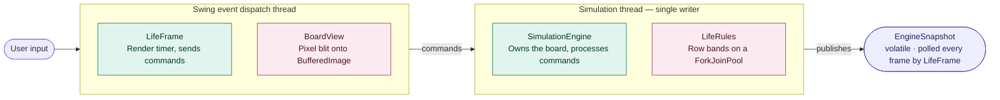
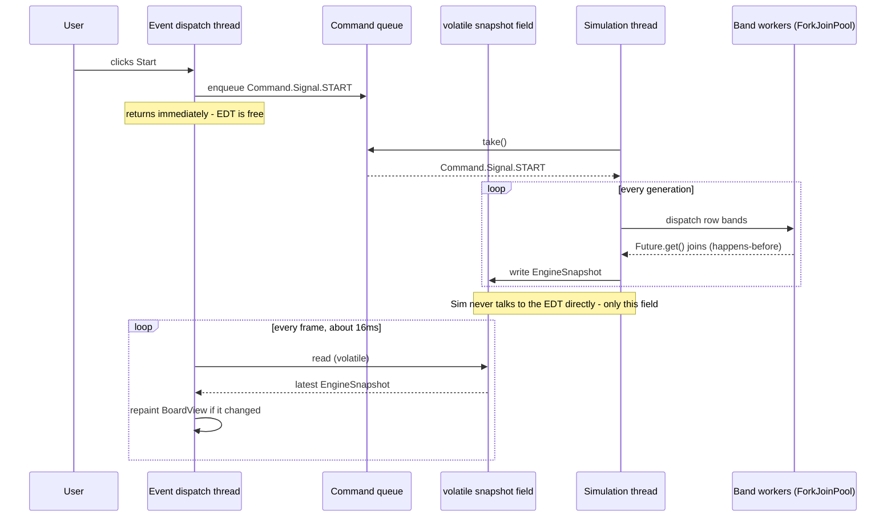

# Conway's Game of Life


A Swing implementation of Conway's Game of Life with a multithreaded rules engine.
The simulation runs on its own thread and publishes immutable snapshots, so the board
renders at a steady frame rate no matter how fast generations are produced.

Requires JDK 21 or newer


## Contents

- [Running](#running)
- [Configuration](#configuration)
- [Architecture](#architecture)
- [Design](#design) — how the threading works, and why
- [Testing](#testing)
- [Benchmark](#benchmark) — including how the executor was chosen
- [JVM flags](#jvm-flags)
- [Further reading](#further-reading)

## Running

```bash
mvn clean package
```

```bash
java -jar target/GuiLife.jar
```

The jar is self-contained; no sibling `libs/` directory is needed.

The board starts with two Gosper glider guns in opposite corners. Click any cell to
toggle it, including while the simulation is running.

| Control | Effect |
| --- | --- |
| Board size | Board labels 200, 400 or 800 (201, 401 or 801 cells; the extra cell is a grid detail). Changing it discards the run and seeds a fresh board, and is only available while stopped |
| Parallel partitions | Number of row bands each generation is split across; defaults to a value chosen for the board and machine, and re-derived whenever the board size changes. Only adjustable while stopped |
| Start / Stop | Run continuously, or pause |
| Next generation | Advance exactly one generation |
| Clear | Empty the board and reset the counter |

Live cells are mint, cells that have died turn plum, and cells where nothing has
ever lived stay near-black.

## Configuration

Every setting is a system property; the defaults are shown.

| Property | Default | Meaning |
| --- | --- | --- |
| `conway.gridSize` | `201` | Board width and height in cells; also the size selected on startup. A value that is not one of the presets is added to the board-size control rather than replaced |
| `conway.boardSizePx` | `1000` | Target board size in pixels; cell size is derived |
| `conway.targetFps` | `60` | Repaint rate, independent of the simulation rate |
| `conway.maxPartitions` | `min(gridSize, max(2, 2 × cores))` | Upper bound for the partition control |
| `conway.partitions` | chosen per board and machine | Partition count to start with; overrides the recommendation |
| `conway.minRowsPerPartition` | `50` | Rows a band needs before splitting again pays off; retunes the recommendation |
| `conway.log.dir` | `logs` | Log directory |
| `conway.log.level` | `INFO` | Root log level |

```bash
java -Dconway.gridSize=401 -Dconway.log.level=DEBUG -jar target/GuiLife.jar
```

## Architecture



Commands flow one way, from the UI into the engine's queue. State flows back only
through `EngineSnapshot`: an immutable bundle published through a single `volatile`
field. The render loop polls it on a fixed timer; nothing pushes to it, and nothing
outside the simulation thread ever touches the board directly.

## Design

The application is a single-writer actor with an immutable-snapshot read path.

### The classes, at a glance

- **[`SimulationEngine`](src/main/java/com/conway/engine/SimulationEngine.java)** owns
  the board. It is the only thread that ever mutates simulation state. Everything
  else — the UI, tests — submits commands to a queue. Pausing blocks on
  `BlockingQueue.take()`, so a queued step request can never be lost and a spurious
  wakeup can never advance the board.
  Threads are split by shape — actor = virtual, workers = `ForkJoinPool`. The actor
  spends its life blocked in `take()` / `Future.get()` / parking between generations,
  so a virtual thread unmounts from its carrier while blocked and costs nothing while
  idle (daemon by default, so the JVM can still exit if a shutdown path is missed).
  `computeBand` never blocks — pure CPU at roughly 50,000 band dispatches per second,
  the one case virtual threads do not address — so the band workers are a
  `ForkJoinPool` sized to `min(maxPartitions, core count)`. Work stealing absorbs uneven bands on
  asymmetric cores instead of idling at the per-generation barrier, and per-worker
  deques beat one contended queue; measured 12–19% faster than virtual-thread workers
  on the default 201 board at 4 partitions, parity on 801 (see
  [Benchmark](#benchmark)).
- **[`Generation`](src/main/java/com/conway/model/Generation.java)** is an immutable
  snapshot published through a single `volatile` field together with its statistics
  ([`EngineSnapshot`](src/main/java/com/conway/engine/support/EngineSnapshot.java)). Readers
  see generation N or N+1 in full, always with the throughput numbers that belong to
  it, and need no lock. Cells are flat `boolean[]` indexed `row * width + col`.
- **[`LifeRules`](src/main/java/com/conway/engine/rules/LifeRules.java)** splits a generation
  into contiguous row bands. Bands write to disjoint slices, so no synchronisation is
  needed between workers; `Future.get()` supplies the happens-before edge. A failing
  band aborts the generation rather than silently producing a wrong board.
- **[`BoardView`](src/main/java/com/conway/ui/BoardView.java)** writes colours into the
  `int[]` backing one `BufferedImage` and performs a single scaled blit.
- **[`LifeFrame`](src/main/java/com/conway/ui/LifeFrame.java)** pulls the newest
  snapshot on a fixed timer. The simulation is not throttled by the repaint rate, and
  the repaint rate is not swamped by the simulation.

The rest of this section explains *why* it is shaped that way. If you have not written
a multithreaded GUI before, this is the interesting part.

### The one constraint everything follows from

Swing has a rule that admits no exceptions: **only the event dispatch thread (the EDT)
may touch a Swing component.** That thread is also the one that delivers button clicks
and repaints the window. So if you compute a generation directly inside a button's
`ActionListener`, the EDT is busy doing that work and cannot repaint or respond to
anything — the window goes grey and the OS reports it as not responding.

Meanwhile, a Game of Life board is real CPU work, repeated forever: at the default
201×201 board the engine produces thousands of generations per second, each one
touching tens of thousands of cells.

Those two facts force the shape of the whole application:

1. The simulation must run on its **own thread**, not the EDT.
2. The EDT must be able to **display** the board without waiting for that thread.
3. The EDT must be able to **control** the simulation without waiting for it either.

Every pattern below is an answer to one of those three points.

### What breaks if you just share the board

The obvious first attempt is one board that both threads use — the simulation thread
writing cells, the EDT reading them to paint. It fails two ways, and the second is the
dangerous one.

**1. Torn reads.** Writing a single `boolean` into an array is atomic, so no one cell is
ever half-written. But nothing makes the board *as a whole* atomic. The simulation thread
needs thousands of writes to finish generation N+1, and the EDT can paint partway through
— producing a frame that is part N, part N+1. Not a stale board: one that never existed.
Gliders tear in half.

**2. Visibility.** Without `volatile` or a lock, the Java Memory Model gives **no
guarantee that one thread's write is ever seen by another**. The JIT may hoist the read
out of the render loop, and each core has its own caches. A perfectly legal outcome is
the EDT painting the starting board forever while the simulation runs behind it — and the
code looks correct the whole time.

Locking fixes both, at a price: the EDT blocks on a lock held by a thread mutating
thousands of times a second, and every future access has to remember to take it.

### The fix: never mutate what another thread can see

Instead of guarding mutation, this codebase removes it. `LifeRules` builds each new board
in *fresh* arrays and transfers ownership via `Generation.adopt(...)`, so a published
`Generation` is never written to again. The entire handoff to other threads is one
assignment:

```java
private volatile EngineSnapshot snapshot;

private void publish(Generation generation, SimulationStats stats) {
    snapshot = new EngineSnapshot(generation, stats);
}
```

It works because of a JMM rule called **safe publication**: writing a reference to a
`volatile` field guarantees that everything the writing thread did *before* that write —
including fully constructing the object — is visible to any thread that later reads the
field. A reader therefore gets a completely built `Generation`, or the previous one.
Never a mixture.

And because the object is immutable, there is no *second* problem: once you hold it,
nothing can change it under you. There is nothing left to lock.

Two consequences worth noticing in the code:

- The board and its statistics are bundled into one `EngineSnapshot` rather than
  published as two fields, so the status bar can never show generation N+1's number
  next to generation N's population.
- Because a new instance is published per change, `BoardView.setGeneration` can test
  `generation != displayed` — plain reference identity — to decide whether anything
  changed. No deep comparison needed.

### Commands travel the other way, through a queue

Point 3 from above: the EDT has to start, stop and edit the simulation without blocking.
It cannot call into the simulation thread's state directly — that would just recreate
the shared-mutable-state problem in the opposite direction.

So every control is a message. `SimulationEngine`'s public methods do nothing except put
an object on a queue:

```java
public void start() { submit(Command.Signal.START); }
public void toggleCell(int row, int col) { submit(new Command.ToggleCell(row, col)); }
```

`Command` is a `sealed interface` implemented by an enum of data-free signals and by
records for the commands that carry data, so the loop that consumes it can `switch` over
every case with the compiler checking that none was forgotten. The EDT returns from
`start()` in microseconds, whatever the engine is doing.

The consuming loop has one detail worth studying:

```java
Command command = running ? commands.poll() : commands.take();
```

- **Running:** `poll()` returns `null` immediately if no command is waiting, so the loop
  falls through and computes the next generation. Commands are still picked up between
  generations.
- **Paused:** `take()` *blocks* until something arrives. An idle engine therefore burns
  no CPU at all, and — unlike a `wait()`/`notify()` pair — a step request that arrives at
  an awkward moment cannot be lost, because it is sitting in the queue rather than being
  a notification that may have already fired.

This is the **actor** pattern: one thread owns the state, and everyone else sends it
messages.

### Inside one generation: parallelism without locks

The board is split into contiguous **row bands**. Band *k* reads the previous generation
(which nobody is writing) and writes only its own rows of the new arrays. Because no two
bands ever touch the same memory, the workers need no coordination with each other at
all — no lock, no atomic, nothing.

Two details in [`LifeRules.next`](src/main/java/com/conway/engine/rules/LifeRules.java) that a
diagram would hide:

- The calling thread does not just dispatch and wait. It submits bands 1..N−1 to the
  executor and then computes **band 0 itself**, so the simulation thread does useful work
  instead of parking for the whole generation.
- Joining is what makes the result safe to read. `Future.get()` blocks until that band is
  done *and* establishes a happens-before edge, which is the guarantee that the worker's
  writes are visible to the joining thread. Band 0 needs no join because the same thread
  wrote it.

Splitting is a pure work-distribution choice: the resulting board must be identical
whatever the band count, which is exactly what
[`PartitionEquivalenceTest`](src/test/java/com/conway/engine/rules/PartitionEquivalenceTest.java)
asserts. That test is the safety net for the whole parallel path.

### Rendering runs on its own clock

A tempting design is "compute a generation, repaint, repeat". This codebase deliberately
does not do that. `LifeFrame` starts a Swing `Timer` at `conway.targetFps` (60 by
default) and, on each tick, reads whatever has been published:

```java
EngineSnapshot snapshot = engine.snapshot();   // one volatile read
```

If the engine produced 300 generations since the last tick, 299 are simply never drawn —
and that is correct, because the display cannot show them anyway. The benefit runs both
ways: the simulation is never throttled by repaint backpressure, and the EDT never has a
frame backlog to work through.

### Trace: one click, end to end



The two loops are independent. Neither ever waits for the other; the only things crossing
between them are a queue in one direction and a single field in the other.

The one exception is lifecycle news — "the engine is now running", "a generation failed".
Those are pushed through [`EngineListener`](src/main/java/com/conway/engine/EngineListener.java),
and because those callbacks run **on the simulation thread**, `LifeFrame` wraps each one
in `SwingUtilities.invokeLater` to hop back onto the EDT before touching a component.
Per-generation updates are deliberately *not* sent this way — that would put the
simulation rate back in charge of the frame rate.

### Concepts glossary

| Term | What it means here |
| --- | --- |
| Event dispatch thread (EDT) | The one thread Swing allows to touch components. Blocking it freezes the UI |
| Torn read | Observing a mix of old and new values because the update was not atomic as a whole |
| Visibility | Whether one thread's write is guaranteed to be seen by another. Not automatic in Java |
| Safe publication | Writing a reference to a `volatile` field so readers see a fully constructed object |
| Happens-before | The JMM ordering guarantee that makes one thread's writes visible to another. Supplied here by `volatile` writes and `Future.get()` |
| Actor | One thread owns mutable state; everyone else sends it messages instead of calling it |
| Single-writer principle | Only one thread ever mutates a piece of state, so reads need no lock |
| Virtual thread | A JDK 21 thread that unmounts from its carrier while blocked, so idle ones cost almost nothing |

The grid is bounded, not toroidal: neighbours off the edge count as dead.

Patterns are data, in the plaintext [`.cells`](src/main/resources/patterns) format,
not hard-coded index assignments.

## Testing

```bash
mvn test
```

Tests are headless and run on a build agent with no display.

The load-bearing test is
[`PartitionEquivalenceTest`](src/test/java/com/conway/engine/rules/PartitionEquivalenceTest.java):
partitioning is a work-distribution concern, so the resulting board must not depend on
how many bands the work was split into. Asserting that directly catches off-by-one
errors at band boundaries, rows computed twice or skipped, and accidental sharing of
mutable state between workers.

## Benchmark

```bash
java -cp target/GuiLife.jar com.conway.bench.GenerationBenchmark
```

Arguments, all optional: grid size, generations per measurement, and the executor —
`platform` (the default), `virtual`, or `forkjoin`.

The default is **not** the path the application takes. `SimulationEngine` uses a
`ForkJoinPool`, while the harness defaults to a fixed platform pool, so measure the
shipping configuration explicitly:

```bash
java -cp target/GuiLife.jar com.conway.bench.GenerationBenchmark 201 300 forkjoin
```

The three modes exist so that a change of executor is settled by measurement rather than
by argument — which is how both the move to virtual threads and the later move away from
them were decided. See [Choosing the executor](#choosing-the-executor).

> **Read the numbers as indicative, not precise.** The harness warms up, resets to an
> identical board before each measurement and takes the best of five — enough to show
> the shape of the curve, but it is not
> [JMH](https://openjdk.org/projects/code-tools/jmh/). It also measures partition counts
> in ascending order inside a single JVM, so later rows inherit a warmer JIT; differences
> between adjacent rows are not reliable. Reach for JMH before drawing any conclusion
> finer than "does adding threads help at all".

Measured on a 201×201 board with the shipping `forkjoin` executor — Apple M2 Pro
(6 performance + 4 efficiency cores), JDK 25, 300 generations per measurement, best result
across four interleaved rounds:

| Partitions requested | Bands actually run | Generations/s | Speedup |
| --- | --- | --- | --- |
| 1 | 1 | 13,131 | 1.00× |
| 2 | 2 | 18,421 | 1.40× |
| 4 | 4 | 19,473 | 1.48× |

What the table establishes is what splitting the work at all is worth on this board —
roughly half as much again — not a sharp optimum; 2 and 4 are close enough that run-to-run
spread can reorder them. The machine also carried about one core of unrelated background
load, so the parallel rows are conservative.

### Choosing the executor

The band workers never block, so the choice of executor is a question about dispatch cost
and load balancing, not about concurrency. All three modes, interleaved to spread
background load evenly, best of four rounds:

| Board | Partitions | `platform` | `virtual` | `forkjoin` |
| --- | --- | --- | --- | --- |
| 201 | 1 | 12,820 | 13,258 | 13,131 |
| 201 | 2 | 18,300 | 17,722 | **18,421** |
| 201 | 4 | 17,268 | 17,422 | **19,473** |
| 201 | 8 | 17,380 | 18,620 | **19,254** |
| 801 | 4 | 3,191 | 3,226 | 3,216 |
| 801 | 16 | 3,636 | 3,833 | 3,865 |

Two things to read from this. At 201 with the recommended four partitions, work stealing
is worth about 12% over virtual threads on the best figures and nearer 19% on the means —
a band there is only ~10,000 cells, so dispatch overhead is a real fraction of the work,
and a `ForkJoinPool`'s per-worker deques beat a fixed pool's single contended queue at
roughly 50,000 dispatches a second. At 801 all three land within ±2.4%, because a band is
four times larger and dispatch cost stops mattering.

The 1-partition row is the control: it computes inline on the calling thread with no
dispatch at all, so all three modes agreeing there says the harness is measuring what it
claims to.

The table stops at 4 on purpose. A generation is split across at most
`activeRows / 50` bands, so on a 201 board every request of 4 or more runs the *same*
four bands — rows for 8, 16 and 20 would repeat row 4's work under different labels, and
any difference between them would be measurement artifact rather than scaling.

**Parallelism buys about 1.5× on this board.** A single generation takes roughly 80 µs,
which is small enough that task dispatch and the join barrier dominate. The simulation is
already about 200× faster than the 60 fps display, so on the default board the threading
has no effect on what you see; decoupling rendering from the simulation is what matters.

### How the default partition count is chosen

Parallelism pays off as a function of the *board*, not the core count. Speedup over a
single partition, same machine and harness:

| Board | 1 | 2 | 4 | 8 | 16 | 20 | Best |
| --- | --- | --- | --- | --- | --- | --- | --- |
| 201 | 1.00× | 1.13× | **1.15×** | 1.11× | 1.08× | 1.03× | 4 |
| 401 | 1.00× | 1.66× | 2.23× | **2.30×** | 2.27× | 2.17× | 8 |
| 801 | 1.00× | 1.80× | 3.13× | 3.07× | **3.53×** | 3.52× | 16 |
| 1601 | 1.00× | 1.86× | 3.39× | 3.95× | 4.92× | **5.10×** | 20 |

Two health warnings on this table. It predates the per-generation band cap, so the
right-hand columns no longer measure distinct configurations (see below). And it is a
different session from the table above — which reports 1.48× where this one reports
1.15× for the same 201 board at 4 partitions. That ~29% disagreement between runs of the
same configuration is the harness's real precision, and a good reason to trust only the
shape of the curve. These rows have not been re-measured since the band cap landed.

At every size the fastest result lands at roughly **fifty rows per band**, and the
largest board is still improving when it hits the cap. That invariant is the rule
[`PartitionPlanner`](src/main/java/com/conway/engine/rules/PartitionPlanner.java) implements:
`clamp(rows / 50, 1, maxPartitions)`. It reproduces the measured optimum at all four
sizes, and it keeps small boards single-threaded instead of paying dispatch cost for
work that does not exist.

Two consequences worth knowing:

- Defaulting to `availableProcessors()` was measurably **slower** than the chosen value
  when these numbers were recorded — 10 partitions sat past the peak. The per-generation
  cap has since made the two equivalent on the default board, because both end up at four
  bands; the planner still earns its place on larger boards, where the request is not
  capped away.
- The cap deliberately allows more bands than cores. These are asymmetric cores
  (6 performance + 4 efficiency); since a generation ends at a barrier, an efficiency
  core given an equal share delays everyone, and smaller bands let the faster cores
  absorb proportionally more.

The constant was calibrated on one machine and one JDK. Retune it for a deployment that
cares with `-Dconway.minRowsPerPartition=N`, or bypass it with `-Dconway.partitions=N`.

The engine applies the same rule again per generation, against the *active region* rather
than the whole board, and computes inline when there is too little live area to fill the
bands. A sparse board is therefore never split: on a 201×201 grid holding a single blinker,
sixteen bands ran 5.4 times slower than computing inline.

That cap also means the high-partition columns above no longer measure what they did when
the table was recorded. A full board now runs at most `rows / 50` bands — four at 201,
eight at 401, sixteen at 801 — so on each row every column at or beyond that point repeats
the same work, and the differences between them are measurement artifact rather than
scaling. Only the 1601 row still varies across all six columns.

## JVM flags

The application is a Swing GUI with a small, steady allocation rate: two `boolean[]` per
generation, which on the default board works out to 1.0–1.5 GB/s depending on the rate
achieved. The default G1 collector already absorbs this with negligible pause (measured
~1.6 ms max per collection, a few ms total over a 20 s run), so the flags below are
optional at this board size; they bound the heap and tighten the pause goal for a smooth
interactive experience:

```bash
java -Xms256m -Xmx1g -XX:MaxGCPauseMillis=20 -jar target/GuiLife.jar
```

- `-Xms256m -Xmx1g` — ample for the default board, where one generation is two 40 KB
  arrays. `-Xms256m` sets only the initial heap size; it is `-Xmx1g` that has to cover
  the live set. A gigabyte is **not** enough near the 10,000×10,000 maximum: a generation
  is 200 MB there (two 100 MB `boolean[]`), and computing the next one allocates a
  further 200 MB before the previous is released. Size `-Xmx` from the board — at least
  `4 × width × height` bytes live, plus headroom for the renderer's copy — or stay near
  the default grid.
- `-XX:MaxGCPauseMillis=20` — lower G1's pause goal from its 200 ms default, so a
  pathological collection is less likely to stall the render loop. The measured pauses
  (~1.6 ms) already sit far inside the 16.7 ms frame budget at 60 fps, so this is
  headroom rather than a fix.
- `-XX:+UseZGC` — optional alternative for very large boards; ZGC's sub-millisecond
  pauses come at higher CPU cost, which is fine for an interactive app but pointless
  at the default board size.

The simulation actor is a virtual thread; the band workers are a `ForkJoinPool` sized to `min(maxPartitions, core count)`
— split by shape, as above: the actor blocks, the bands never do. A JDK
21 JFR recording taken while both the actor *and* the band workers
were virtual captured zero `jdk.VirtualThreadPinned` events with the threshold lowered to
0 ms, so nothing in the engine's blocking paths pins a carrier. Background in
[`docs/java21-migration.md`](docs/java21-migration.md).

## Further reading

The engineering behind the design decisions above is written up in `docs/`:

| Document | What it covers |
| --- | --- |
| [Java 21 migration](docs/java21-migration.md) | What changed moving 17 → 21 and why: virtual threads, the single volatile snapshot, JMM and GC cleanup |
| [Concurrency features review](docs/concurrency-features-review.md) | Every Java ≤21 concurrency tool weighed against this codebase, including what was rejected and the reason |
| [Profiling findings](docs/profiling-findings.md) | Analysis of a VisualVM snapshot and thread dump, with the findings a later clean JFR profile overturned marked as such |
| [Profiling fixes](docs/profiling-issues-fixing-progress.md) | What was done about each finding — incremental rendering, band capping, and the ones deliberately not fixed |
| [Migration plan](docs/java21-migration-plan.md) | The original tracking document for the migration |
