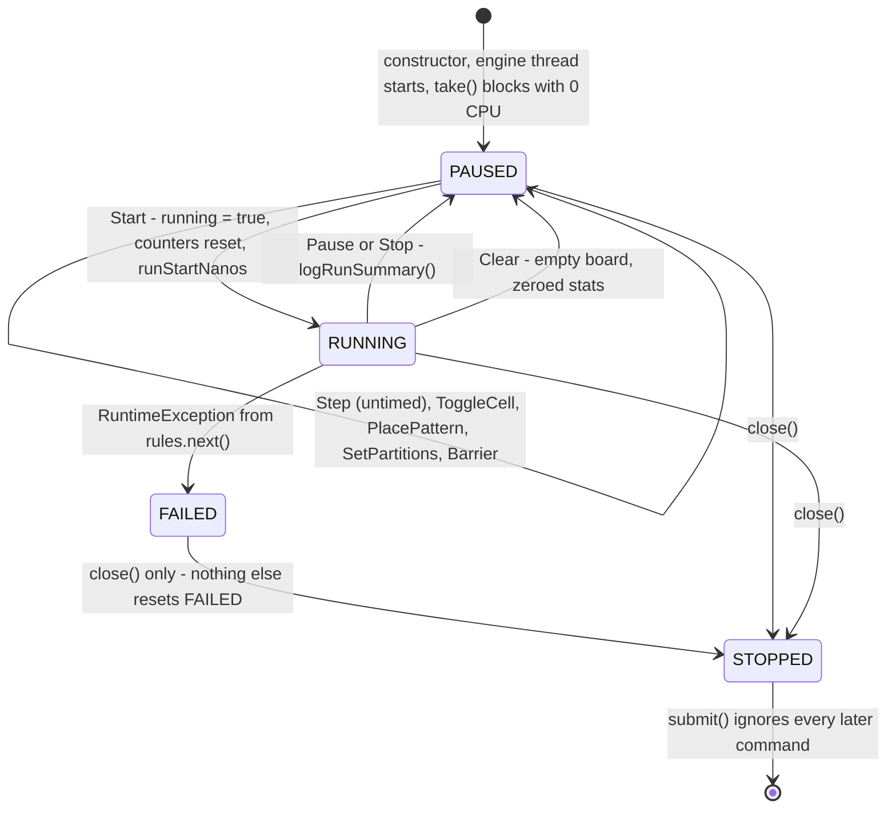
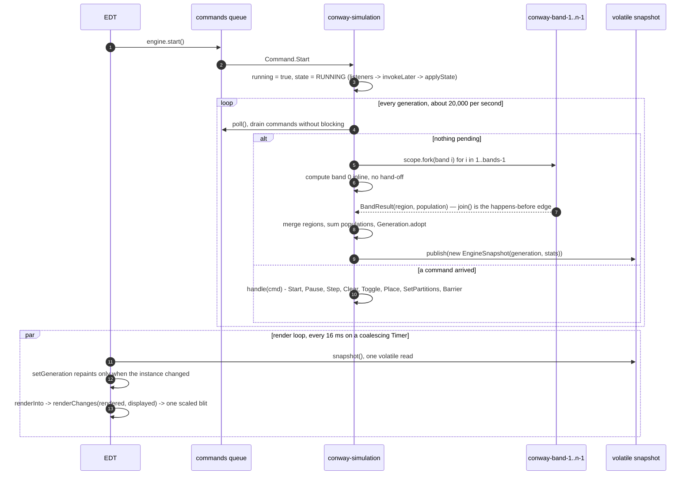

# Application architecture and lifecycle

How a run gets from `main()` to a window full of generations, and back down again. Every step
below names the method that performs it and the log line that proves it happened, so the
diagrams can be checked against a snapshot in `profiling/` rather than trusted.

**Viewing this file.** Section 2 embeds committed SVG images (`docs/diagrams/*.svg`, beside
their `*.mmd` sources), so the lifecycle reads in any Markdown viewer. Sections 3–4 are
inline Mermaid, which IntelliJ IDEA renders in the Markdown preview (built in since 2023.1;
the Markdown plugin is bundled in Community and Ultimate). If a build shows raw Mermaid
text, enable *Settings -> Languages & Frameworks -> Markdown -> Mermaid* (older builds need
the *Mermaid* plugin from JetBrains Marketplace), or read the ASCII diagram in
[section 5](#5-same-lifecycle-in-ascii), which needs no tooling at all. To re-render the
lifecycle images after editing a source: `npx --yes @mermaid-js/mermaid-cli -i
docs/diagrams/lifecycle-<name>.mmd -o docs/diagrams/lifecycle-<name>.svg`.

- **Split view:** open the file, then the **Editor and Preview** icon at the top right of the
  editor, or `Cmd+Shift+P` / `Ctrl+Shift+P` ("Show Markdown Preview").

## 1. The actors

| Actor | Thread | Owns |
| --- | --- | --- |
| Startup | `main` | config, engine construction, seeding, window launch |
| Engine | `conway-simulation` (virtual, started in the constructor) | the board, the command queue, the snapshot — the **only** mutator |
| Renderer | `AWT-EventQueue-0` (EDT) | `LifeFrame`, `BoardView` and its `BufferedImage`; pulls the snapshot, never touches engine state |
| Bands | `conway-band-0…n` (virtual, one per band per generation) | one row range each, inside a single `StructuredTaskScope` |

## 2. Application lifecycle

Three small diagrams — a linear startup, a three-node run loop, and a linear shutdown. Read
top to bottom; each numbered step's code and log line are in
[section 6](#6-step-code-and-evidence). The same diagrams are committed as images
(`docs/diagrams/lifecycle-*.svg`, sources beside them in `*.mmd`, rendered with
`npx --yes @mermaid-js/mermaid-cli -i <name>.mmd -o <name>.svg`), so this section reads in
any Markdown viewer even where Mermaid itself does not render.

### 2.1 Startup — main thread

The window does not exist yet; the engine is built, configured, seeded, and the seeder's
`sync(5 s)` barrier guarantees the first frame shows the board, not an empty grid.



### 2.2 Run loop — engine thread

At most three live nodes. `FAILED` is a dead end: nothing but `close()` leaves it.



### 2.3 Shutdown

Board-size changes (`LifeFrame.applyBoardSize`, spinner, stopped engine only) re-enter
[§2.1](#21-startup--main-thread) with a **new** engine: the grid and the backing image are
both fixed at construction, so there is no resize path.



**Verified nuance about step 1.** `Application started` appears in none of the round-3/4/5
recordings (`grep -rl 'Application started' profiling/` finds nothing) while `LifeConfig`,
`Simulation thread started` and `GUI started` are all present. The harness `drive.GuiDrive`
therefore performs Main's sequence itself instead of calling `com.conway.Main.main`; the
lifecycle is identical either way, only that one log line is absent.

## 3. Engine state machine

`SimulationEngine.State`, written by `setState` on the engine thread and delivered to the EDT
through `EngineListener.onStateChanged` -> `SwingUtilities.invokeLater`.



`FAILED` renders as "Idle" in the status bar, because `applyState` keys off `RUNNING` alone —
the modal dialog carries the error, so the state label by itself does not tell a user that a
generation blew up.

## 4. Steady state — one generation against one frame



## 5. Same lifecycle in ASCII

```
 main (startup)          conway-simulation (virtual)              EDT (AWT-EventQueue-0)
      |                              |                                     |
 (1)  | config + uncaught handler    |                                     |
 (2)  | new SimulationEngine -------->| runLoop: take() [PAUSED, 0 CPU]     |
 (3)  | setPartitions(4) ----------->| SetPartitions -> publish(stats)     |
 (4)  | seedBoard: place x2 -------->| PlacePattern x2 -> publish(board)   |
      |   sync(5 s) ---- Barrier --->| latch.countDown()                   |
 (5)  | launch() --------------------------------------------------------->| Theme.install
      |                              |                    new LifeFrame ----| BoardView: BufferedImage
      |                              |                    setVisible, startRendering
 (6)  |                              | take() blocks -+                    | Timer 16 ms -> refresh()
      |                              |                |                    |   snapshot() one volatile read
 (7)  |                              |<---- Start ----+--------------------|
      |                              | running = true                      |
      |                              | poll() -> null -> advance(true)     |
      |                              |   +-- fork bands 1..n-1 --> [bands] |
      |                              |   +-- band 0 inline                 |
      |                              |   +-- join -> adopt -> publish ---->| renderChanges -> blit
      |                              |           (repeat ~20,000/s)        |        (62.5/s)
 (8)  |                              |<---- close() -----------------------| windowClosed / Quit
      |                              | running = false -> logRunSummary    |
 (9)  |                              | shutdownRequested -> exit loop      |
      |                              | releasePendingBarriers() -> STOPPED |
 (10) |                              x joined (5 s, else interrupt)        | process ends
```

## 6. Step, code and evidence

| # | Step | Code | Log line that proves it |
| --- | --- | --- | --- |
| 1 | config and global handler | `Main.java:23-26`, `LifeConfig.fromSystemProperties()` | `Configuration: grid 201x201, cell 4px, target 60 fps, partitions 4 of at most 20` |
| 2 | engine and engine thread | `Main.java:27-28`, `SimulationEngine` constructor | `Simulation thread started` |
| 3 | partition count | `Main.java:31` -> `Command.SetPartitions` | `Partition count changed to 4` |
| 4 | seed two glider guns | `SimulationSeeder.seedBoard` -> `Command.PlacePattern`, `sync` -> `Command.Barrier` | silent unless the 5 s timeout trips |
| 5 | window up | `LifeGuiLauncher.launch`, `LifeFrame` constructor | `GUI started` |
| 6 | idle | `runLoop` (`commands.take()`), `LifeFrame.refresh` | none — by design, 0 CPU |
| 7 | generation loop | `advance(true)` -> `LifeRules.next` -> `computeInParallel` (`StructuredTaskScope`, `bandsFor`) | `Run started with 4 partition(s)` |
| ! | band failure | `advance` catch -> `setState(FAILED)` -> `onError` -> `showError` | `Generation N failed; simulation paused` |
| 8 | stop requested | `LifeFrame.shutdown` -> `SimulationEngine.close` | `Shutting down simulation engine` |
| 9 | drain and exit loop | `runLoop` finally -> `releasePendingBarriers()` | `Run finished: 2,000,091 generations in 99.026 s using 4 partition(s), 20197.7 generations/s` |
| 10 | join and publish state | `close()`: `join(5 s)`, then `setState(STOPPED)` | `Simulation thread finished`, `Simulation engine stopped` |
|  | board-size change re-enters 2-5 with a **new** engine | `LifeFrame.applyBoardSize` | `Board size changing from 201 to 401` |

Two things that are easy to get wrong when reading the diagrams above:

- **Seeding completes before the window exists.** `SimulationSeeder.sync` blocks on a
  `Command.Barrier`, which guarantees the first frame shows the seeded board rather than an
  empty one.
- **A board-size change is not a resize.** `LifeFrame.applyBoardSize` closes the engine and
  constructs a new one, because both the grid and the view's backing image are fixed at
  construction.

The rates in the last step are worth keeping in view: the engine publishes ~20,000 snapshots/s
(`advance(true)`) while the EDT consumes 62.5/s (a 16 ms coalescing `Timer`). That ratio is why
the render path is one volatile read plus a differential redraw instead of a repaint per
generation — but it is **not** what makes array reuse safe; see the *buffer reuse* subsection of
`PROFILING-LOG.md`.